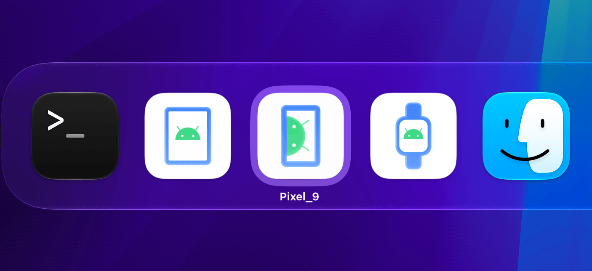

# @androperator/emulator-macos-tweaks

A completely and utterly unessential utility that makes Android™ emulators feel more at home on macOS. Give your phone, tablet, TV, watch and automotive emulators distinct icons that fit in with the rest of your apps, with safe backups and an easy way to undo the changes.

**With `androperator-emulator-tweaks`:**



**Without `androperator-emulator-tweaks`:**


Per-device icons are supported by the CLI. The `Pixel_9` label in the screenshot uses the [experimental AVD naming launcher](experimental/README.md); ordinary CLI-patched launches keep their executable label.

This is an independent CLI. It does not depend on ADBuddy or change emulator launch arguments, virtual devices, headless emulators, or Android Studio itself.

## Requirements and supported builds

- macOS 14 or newer and Node.js 22 or newer.
- Write access to your Android SDK and backup location; do not run with sudo.
- Android Emulator **37.1.11, build 15917651, Apple Silicon GUI binary**.
- Executable SHA-256: `eaa97a970b81f81640db73ed79e19ee173323653a0a1203217e1199d078011f3`.

This first release intentionally supports one verified binary. Intel and other emulator builds are reported as unsupported and refused. Matching the version number alone is insufficient: the entire original executable and its embedded icon images must match the support profile.

Patching replaces Google's signature with a **local ad-hoc signature**, preserving the original entitlements and hardened runtime. The modified emulator is no longer Google-signed or notarized. No developer certificate or private key is used. Gatekeeper may treat the patched emulator differently. The CLI does not disable Gatekeeper or change system security settings.

Automatic icons use a bundled arm64 AppKit helper loaded by a verified weak dependency added to the supported GUI executable. No Xcode, background service or launch wrapper is needed for CLI users. The helper selects artwork from the AVD metadata separately for each process and keeps it through Qt icon updates.

Every `apply` invocation requires `--accept-adhoc-signing` to acknowledge this tradeoff, including repeated calls and reapplying a saved patch. Without it, the CLI explains the change and exits before SDK discovery or file modification. `status` and `restore` do not require the flag. Restore reinstates the exact original executable and Google’s original signature.

## Install and use

Once published:

```sh
npm install -g @androperator/emulator-macos-tweaks
androperator-emulator-tweaks status
androperator-emulator-tweaks apply --accept-adhoc-signing
androperator-emulator-tweaks restore
```

For a local checkout before publication:

```sh
npm test
node bin/androperator-emulator-tweaks.js status
node bin/androperator-emulator-tweaks.js apply --accept-adhoc-signing
node bin/androperator-emulator-tweaks.js restore
```

SDK discovery checks `--sdk`, then `ANDROID_HOME`, `ANDROID_SDK_ROOT`, and `~/Library/Android/sdk`. Automatic discovery selects the first existing SDK; an explicit `--sdk` never falls back to another SDK.

```sh
androperator-emulator-tweaks apply --accept-adhoc-signing --sdk "$HOME/Library/Android/sdk"
androperator-emulator-tweaks status --json
# Optional fixed phone artwork instead of automatic device selection:
androperator-emulator-tweaks apply --accept-adhoc-signing --icons phone
```

Restart your emulator after applying or restoring. Existing running processes keep their current icon. Future standalone launches through Android Studio, the terminal, or other apps use the patched executable in that SDK. The artwork uses Apple's macOS 27 icon shape and lighting; it does not dynamically switch Liquid Glass appearances. Automatic selection reads initial AVD configuration, not live rotation or folding. Wear, TV and automotive tags take precedence; known tablet profiles or a configured minimum width of 600 density-independent pixels select tablet. Foldable profiles remain phone. Unknown or missing metadata falls back to phone. AVD metadata follows Android environment roots and custom `.ini` pointers; `-datadir` does not replace the named AVD's metadata. Android Studio embedded mode has not been validated.

## Backups and restoration

Backups live in `~/Library/Application Support/emulator-icon-macos/backups`. This existing directory name is retained across the rename so earlier backups remain usable. The CLI prints the specific backup directory. Each SDK executable has its own directory, with separate records for each original executable hash and automatic runtime generation. Each record contains the untouched original executable, signed patched executable, original entitlements, the automatic runtime where applicable, and a receipt with hashes and image locations. No emulator binaries are distributed in the npm package.

Automatic backups contain the exact helper and five artwork files used by that generation. Their hashes are checked before apply or reapply; `status` reports the selected icon mode and runtime health. The executable uses an absolute helper path within that backup. Keep the backup at its original location while the patch is installed. Removing the helper allows startup through its weak dependency, with the fixed phone artwork as fallback; a corrupt helper may prevent startup. `restore` remains available when runtime files are missing or corrupt.

`restore` verifies both the current patch and the original backup before atomically replacing the executable. Repeated apply or restore commands are safe. Restore removes the loading hook by reinstating the exact original executable; retained backups include the runtime for reapplication and processes that are still running. Runtime upgrades create a new generation without overwriting earlier backups. Applying automatic icons over a CLI-managed phone patch preserves that patch and builds from its verified original. `--icons phone` can switch back to the earlier fixed-icon behavior. SDK updates may remove the patch: the tool keeps the old backup and refuses to restore it over an updated binary. You can apply again only once that new build is supported.

You may choose a backup location with `--backup-dir PATH`. Use the same location for status, apply, and restore. Moving or deleting backups prevents automatic restoration. Treat the receipt and backup files as part of the backup, not disposable cache files.

The SDK directory lock prevents overlapping mutations, even with different backup directories. Its existing `.emulator-icon-macos.lock` name is retained so old and renamed CLI copies share the same lock. If a process is forcibly killed, it may leave `.emulator-icon-macos.lock` beside the executable. Check `owner.json` and confirm the process is no longer running before removing that specific lock directory. There is no automatic stale-lock deletion.

An interrupted run after signing has a prepared receipt and can recover on the next apply or restore. Earlier failures leave a `.prepare-*` folder in the backup directory for inspection; it is not used as a completed backup. Never delete backups until you have verified the SDK is restored or replaced by an SDK update.

### Migrating the earlier local prototype

If you installed the prototype from a previous experiment, first run its own restore command. The CLI refuses to adopt an unrecognized pre-existing patch, even if it looks identical. Then run this CLI's `apply --accept-adhoc-signing` to create a managed backup.

## Experimental AVD names

[Experimental tooling](experimental/README.md) provides optional per-AVD named
preview launchers in temporary SDK copies. Naming is excluded from the npm
package and has not been integrated with ordinary installed-SDK launches.
The main CLI changes icons only; it does not rename Dock entries.

## Development and release

```sh
npm test
npm pack --dry-run
# Developers with Xcode and a graphical macOS session:
node scripts/verify-icons.mjs
```

Tests use synthetic executables and fake process integrations. They require neither an Android SDK nor a device. macOS CI runs on Node.js 22 and 24. Real signing and boot checks supplement these tests for the supported build.

To add support for a build, use an untouched, signature-verified vendor executable. Record its revision, build ID, architecture, full SHA-256, and each original PNG hash and allocation length in `src/profiles.json`. The patcher discovers images by content rather than fixed offsets. Provide replacement PNGs that fit those allocations exactly, with valid chunks and checksums. Verify signing, boot, Dock appearance, and exact restore on that build before adding it to the support table. Do not loosen hash checks to accept a new build.

The editable `assets/Emulator.icon` source uses a vector phone/Android symbol, white background, and Apple's native icon renderer. The bundled 32, 128 and 256 pixel PNGs were compiled with Xcode's asset compiler and palette-compressed to fit the emulator's allocations. Xcode is not required by CLI users. Native helper source is in `native/`; `node scripts/build-runtime.mjs` rebuilds the packaged arm64 helper and all five icons and writes their content manifest. Rebuild and run native verification after changing those sources; review the regenerated manifest and runtime files together.

Releases are prepared through reviewed PRs, then published from version tags using GitHub Trusted Publishing. See [the release guide](docs/releasing.md) and [release skill](.agents/skills/release-package/SKILL.md). On macOS, `npm run release:pack` validates a temporary installation of the archive without modifying your SDK. Publishing requires explicit authorization.

## License and attribution

Code is licensed under [Apache 2.0](LICENSE). See [LICENSE](LICENSE) and [NOTICE.md](NOTICE.md) for artwork attribution and third-party notices.

Android is a trademark of Google LLC. This project is not affiliated with or endorsed by Google or Apple.

Written by clankers. Engineered by [@chrismlacy](https://x.com/chrismlacy).

Copyright (C) 2026 Action Launcher Pty Ltd
