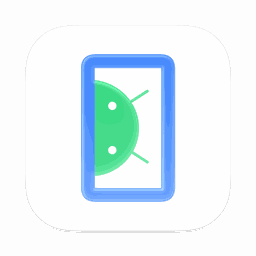

# @androperator/emulator-icon-macos

Give the standalone Android™ Emulator a native macOS Dock icon. Apply a verified patch and restore the exact original executable whenever you want.



This is an independent CLI. It does not depend on ADBuddy or change emulator launch arguments, virtual devices, headless emulators, or Android Studio itself.

## Requirements and supported builds

- macOS and Node.js 22 or newer.
- Write access to your Android SDK and backup location; do not run with sudo.
- Android Emulator **37.1.11, build 15917651, Apple Silicon GUI binary**.
- Executable SHA-256: `eaa97a970b81f81640db73ed79e19ee173323653a0a1203217e1199d078011f3`.

This first release intentionally supports one verified binary. Intel and other emulator builds are reported as unsupported and refused. Matching the version number alone is insufficient: the entire original executable and its embedded icon images must match the support profile.

Patching replaces Google's signature with a **local ad-hoc signature**, preserving the original entitlements and hardened runtime. The modified emulator is no longer Google-signed or notarized. No developer certificate or private key is used. Gatekeeper may treat the patched emulator differently. The CLI does not disable Gatekeeper or change system security settings.

Every `apply` invocation requires `--accept-adhoc-signing` to acknowledge this tradeoff, including repeated calls and reapplying a saved patch. Without it, the CLI explains the change and exits before SDK discovery or file modification. `status` and `restore` do not require the flag. Restore reinstates the exact original executable and Google’s original signature.

## Install and use

Once published:

```sh
npm install -g @androperator/emulator-icon-macos
androperator-emulator-icon status
androperator-emulator-icon apply --accept-adhoc-signing
androperator-emulator-icon restore
```

For a local checkout before publication:

```sh
npm test
node bin/androperator-emulator-icon.js status
node bin/androperator-emulator-icon.js apply --accept-adhoc-signing
node bin/androperator-emulator-icon.js restore
```

SDK discovery checks `--sdk`, then `ANDROID_HOME`, `ANDROID_SDK_ROOT`, and `~/Library/Android/sdk`. Automatic discovery selects the first existing SDK; an explicit `--sdk` never falls back to another SDK.

```sh
androperator-emulator-icon apply --accept-adhoc-signing --sdk "$HOME/Library/Android/sdk"
androperator-emulator-icon status --json
```

Restart your emulator after applying or restoring. Existing running processes keep their current icon. Future standalone launches through Android Studio, the terminal, or other apps use the patched executable in that SDK. The icon is a static rendering of Apple's macOS 27 icon shape and lighting; it does not dynamically switch Liquid Glass appearances.

## Backups and restoration

Backups live in `~/Library/Application Support/emulator-icon-macos/backups`. The CLI prints the specific backup directory. Each SDK executable has its own directory, with separate records for each original executable hash. Each record contains the untouched original executable, signed patched executable, original entitlements, and a receipt with hashes and image locations. No emulator binaries are distributed in the npm package.

`restore` verifies both the current patch and the original backup before atomically replacing the executable. Repeated apply or restore commands are safe. SDK updates may remove the patch: the tool keeps the old backup and refuses to restore it over an updated binary. You can apply again only once that new build is supported.

You may choose a backup location with `--backup-dir PATH`. Use the same location for status, apply, and restore. Moving or deleting backups prevents automatic restoration. Treat the receipt and backup files as part of the backup, not disposable cache files.

The SDK directory lock prevents overlapping mutations, even with different backup directories. If a process is forcibly killed, it may leave `.emulator-icon-macos.lock` beside the executable. Check `owner.json` and confirm the process is no longer running before removing that specific lock directory. There is no automatic stale-lock deletion.

An interrupted run after signing has a prepared receipt and can recover on the next apply or restore. Earlier failures leave a `.prepare-*` folder in the backup directory for inspection; it is not used as a completed backup. Never delete backups until you have verified the SDK is restored or replaced by an SDK update.

### Migrating the earlier local prototype

If you installed the prototype from a previous experiment, first run its own restore command. The CLI refuses to adopt an unrecognized pre-existing patch, even if it looks identical. Then run this CLI's `apply --accept-adhoc-signing` to create a managed backup.

## Experimental per-device icons

An isolated [automatic icon prototype](https://github.com/chrislacy/emulator-icon-macos/blob/feat/native-emulator-icon/prototype/README.md) can select phone,
tablet, TV, watch and automotive icons for each process in a temporary SDK copy.
It requires Xcode and does not change the installed emulator or the stable CLI.

## Development and release

```sh
npm test
npm pack --dry-run
```

Tests use synthetic executables and fake process integrations. They require neither an Android SDK nor a device. macOS CI runs on Node.js 22 and 24. Real signing and boot checks supplement these tests for the supported build.

To add support for a build, use an untouched, signature-verified vendor executable. Record its revision, build ID, architecture, full SHA-256, and each original PNG hash and allocation length in `src/profiles.json`. The patcher discovers images by content rather than fixed offsets. Provide replacement PNGs that fit those allocations exactly, with valid chunks and checksums. Verify signing, boot, Dock appearance, and exact restore on that build before adding it to the support table. Do not loosen hash checks to accept a new build.

The editable `assets/Emulator.icon` source uses a vector phone/Android symbol, white background, and Apple's native icon renderer. The bundled 32, 128 and 256 pixel PNGs were compiled with Xcode's asset compiler and palette-compressed to fit the emulator's allocations. Xcode is not required by CLI users.

Before publishing, run the tests and inspect the package contents, update the version and release notes, and publish explicitly with `npm publish --access public`. This repository has no automatic publishing workflow.

## License and attribution

CLI code is MIT licensed. See [LICENSE](LICENSE) and [NOTICE.md](NOTICE.md) for artwork attribution and third-party notices.

Android is a trademark of Google LLC. This project is not affiliated with or endorsed by Google or Apple.
